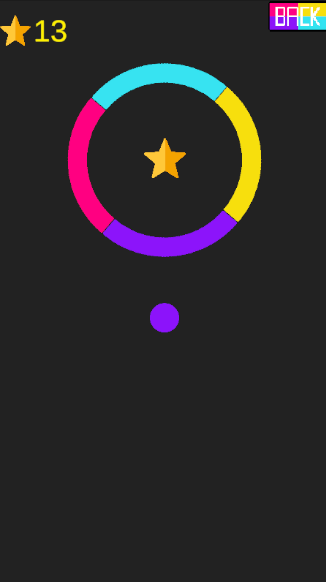

# Hue Hop

A color-matching vertical arcade game made with Unity 6. Tap to bounce your ball upward and pass only through the parts of each obstacle that match your current color.

**▶ Play in your browser:** [enskrkmz.itch.io/hue-hop](https://enskrkmz.itch.io/hue-hop)

## How to Play

| Action | Control |
|---|---|
| Jump | Click / Tap |

- Pass through obstacle segments that match your ball's color.
- Touch a color changer to get a new color.
- Collect stars for points.
- Reach the finish flag to move on to the next level.

## Features

- 5 handcrafted levels with a level select menu
- Rotating rings, counter-rotating mirrored double rings and spinning squares
- Animated menu transitions
- In-game menu button to return to the main menu at any time
- Volume setting saved between sessions
- Works with both mouse and touch (new Input System)

## Built With

- Unity 6 (6000.3 LTS)
- C#
- Unity Input System

## What I Learned

- **Using a GameManager for its purpose:** the ball only detects collisions, and the GameManager makes the decisions.
- **Prefab-based levels:** the shared core of every level lives in one prefab, so a single change applies to all 5 levels.
- **Camera, UI and saving:** a smooth camera that only moves upward with `Lerp` in `LateUpdate`, animated menu transitions with the Animator, and stars and volume saved with `PlayerPrefs`.
- **Unity functions:** working with many Unity functions such as coroutines, `OnTriggerEnter2D`, `SceneManager`, `AddForce`, `Transform.Rotate` and `SetActive`.
- **New Input System:** the same code works with both mouse and touch.

## Credits

- Inspired by *Color Switch*. This is a learning project and is not affiliated with the original game.
- All code and UI buttons: made by me.
- Logo, in-game sprites and music: created with AI assistance.
